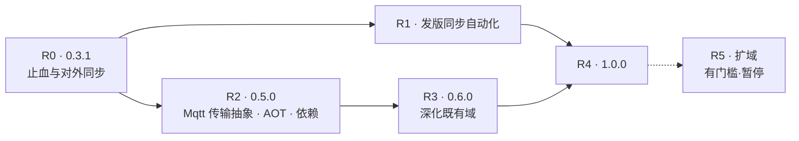

# Observables 路线图

本文件只写**现在和接下来**：阶段划分、排序与出口条件。工程标准（中央包管理、警告策略、诊断治理、命名）以 [`AGENTS.md`](../AGENTS.md) 为权威；版本历史见 [`CONTRIBUTING.md`](../CONTRIBUTING.md) 版本表与 GitHub Releases。

> 版本号、tag、发版均须维护者明确批准；本文件中的版本号为规划占位，不构成自动发版授权。

## 现状基线（2026-10）

| 维度 | 现状 |
|------|------|
| 已实现域 | **Events**、**RestAPI**、**SignalR**、**Mqtt**、**WebSocket**、**Grpc**、**Sse**、**Nats**、**Postgres**、**Redis**（运行时 + 双路生成器 + 测试） |
| nuget.org | **`0.4.1`**（**20 包** + 20 snupkg） |
| 诊断 | **82** 个已发布唯一 ID（以各 `AnalyzerReleases.Shipped.md` 为准） |
| 质量 | Windows + Ubuntu CI；`337d576` 上 1550 测试全绿；`PackVerify` + 23 个 `eng/nuget-smoke` 消费者 |
| 对外文档 | Observables.Docs / Samples 已追到 **`0.3.1`**（[Docs#28](https://github.com/Skymly/Observables.Docs/pull/28)、[Samples#21](https://github.com/Skymly/Observables.Samples/pull/21) / [#22](https://github.com/Skymly/Observables.Samples/pull/22)）。nuget.org `0.2.2` Reactive 包的未声明 R3 引用仍在；维护者决定暂不 deprecate（R0-5） |
| 需求信号 | Issue 全部来自维护者；真实消费方仅 [GitPulse](https://github.com/Skymly/GitPulse)。无外部反馈 |
| 依赖 | MQTTnet `4.3.7`（上游 5.x）；System.Reactive `6.0.1`（上游 7.0）；R3 `1.3.0` |

### 方向判断

1. **对外一致性优先于新功能**：R0 已把 Docs / Samples 追到 `0.3.1`；三仓仍靠手工同步，流程修复留在 R1。
2. **审计驱动加固已到收益递减点**：近期多个探针 issue 结论为「未复现」（#606 / #609 / #610）。不再主动开审计 / 探针批次，转向深化既有域（R3）。
3. **扩域暂停**：无外部需求时，每个新域都是 2 包 + 测试矩阵 + 两仓文档的长期成本（R5）。
4. **正式发 `1.0.0`**：结束「post-1.0 维护期 / 实际 0.x」的版本叙事歧义（R4）。

## 阶段

R1 与 R2 可并行。R4 依赖 R1、R2 出口满足，且 R3 至少完成 R3-1（与下方 R4 前提一致；R3-2–R3-4 可在 1.0.0 前落地或出局，不阻塞 R4）。

### R0 — `0.3.1`：止血与对外同步 ✅

**目标**：已获批的补丁发版，并让 Docs / Samples 追上 nuget.org。

| # | 行动项 | 说明 |
|---|--------|------|
| R0-1 | ✅ 发 `0.3.1` | 内容见 [#622](https://github.com/Skymly/Observables/issues/622) 发版草案：OBS9002/10002/11002 消费者包 ID、RestAPI 同步代理死锁、setter / ref 成员改报 `OBS*004`。20 包，无新公共 API |
| R0-2 | ✅ Docs 版本页 → `0.3.1` | 中英 `index` / `getting-started` / `reference` / `samples`（[Docs#28](https://github.com/Skymly/Observables.Docs/pull/28)） |
| R0-3 | ✅ Samples 版本钉 → `0.3.1` | `ObservablesPackageVersion` + README（[Samples#21](https://github.com/Skymly/Observables.Samples/pull/21)）；本地源码模式修复（[Samples#22](https://github.com/Skymly/Observables.Samples/pull/22)） |
| R0-4 | ✅ GitHub Release `v0.3.1` | 稳定版，tag + NuGet 后创建 |
| R0-5 | nuget.org 将 `0.2.2` 标 deprecated | **维护者决定暂不做**（2026-10-11）；需要时再议，仍不覆盖、不重发 |

**出口**：nuget.org `0.3.1` 20 包可见；Docs / Samples 无 `0.2.2` 当前版本引用。

### R1 — 发版同步自动化（0.3.x 期间，不需发包）

**目标**：发版后 Docs / Samples 不再依赖人工同步。

| # | 行动项 | 说明 |
|---|--------|------|
| R1-1 | Docs 单点版本 | VitePress 全局变量承载当前版本；页面与 nuget 链接引用变量，不再硬编码 |
| R1-2 | Samples 自动跟版 | Dependabot / Renovate 跟踪 `Observables.*`，或 `release.yml` 发布成功后向 Docs / Samples 开同步 PR（二选一，实施时定） |
| R1-3 | 跨仓漂移检查 | Docs / Samples CI 断言引用版本 = nuget.org 最新稳定版 |
| R1-4 | 发版门槛对齐 | `Publish` 已内置 `Test` → `PackVerify`；门槛清单改为「Publish 内 PackVerify 通过」，不再要求 HEAD 上另跑 `CiPack` |
| R1-5 | 测试隔离：全局序列化注册表 | 修改 `*PayloadSerializers` 的测试未禁止并行，会污染同程序集其它测试（Mqtt 已在 CI 偶发失败）。Mqtt [#630](https://github.com/Skymly/Observables/issues/630)；Redis / Nats / Postgres（潜在）[#631](https://github.com/Skymly/Observables/issues/631) / [#632](https://github.com/Skymly/Observables/issues/632) / [#633](https://github.com/Skymly/Observables/issues/633)。仅改测试 |

**出口**：下一次发版（`0.5.0`）三仓同步不含手工改版本号步骤；#630–#633 关闭。

### R2 — `0.5.0`：Mqtt 传输抽象、AOT、依赖升级

**目标**：容纳破坏性变更的 minor 版本。

#### R2-A Mqtt 传输抽象 + MQTTnet 适配包（维护者已定）

背景：`MQTTnet.Client.IMqttClient` 出现在 Mqtt 域公共 API 与生成代码中；MQTTnet 5 移除了 `MQTTnet.Client` 命名空间，同一程序集无法同时支持 4 与 5。

决定：域运行时只依赖 Observables 自有传输抽象；MQTTnet 4 / 5 各由一个**可选扩展包**适配。功能稳定后**冻结 MQTTnet 4 适配包**，此后只跟进 MQTTnet 最新版。

| # | 行动项 | 说明 |
|---|--------|------|
| R2-A1 | ADR-004（先于代码） | 定：传输抽象形状（subscribe / unsubscribe / publish / 能力位，供 MQTT 5 请求-响应）；适配包 ID（暂拟 `Observables.Mqtt.MQTTnet4` / `Observables.Mqtt.MQTTnet5`）；R3 / Reactive 主包是否默认依赖某个适配包；`MqttService.For<T>` 新入口与旧 `IMqttClient` 重载的去留；4.x 冻结的触发条件与版本。须明确放宽 AGENTS「每域仅两个消费者包」——适配包为后端中立的可选扩展，不是第三个消费者主包 |
| R2-A2 | 运行时 + 生成器改造 | `Observables.Mqtt` 去除 MQTTnet 引用；`MqttProtocol` / 协议桥改走抽象；生成代码不再出现 `MQTTnet.*` 类型 |
| R2-A3 | 两个适配包 | 各自 E2E（进程内 broker 分别用 MQTTnet 4 / 5）；登记 BuildManifest；PackVerify 支持「单包、后端中立」包形态（禁止引用 R3 / System.Reactive） |
| R2-A4 | 迁移文档 | Docs Mqtt 页 + 0.4.x → 0.5.0 迁移说明；Samples Mqtt 改用适配包 |

#### R2-B 其它

| # | 行动项 | 说明 |
|---|--------|------|
| R2-B1 | JSON source-gen（AOT） | RestAPI / Mqtt / Redis 设计文档均列为 follow-up；做成全库统一的 `JsonTypeInfo` 序列化入口，而非各域各做 |
| R2-B2 | System.Reactive 7 兼容 | 加钉 Rx 7 的 smoke 消费者；据结果决定下限是否上调 |
| R2-B3 | R3 `1.3.x` 补丁升级 | 常规依赖跟进 |
| R2-B4 | 清理 | `OBS7004` 无触发分支：删除（`AnalyzerReleases` 登记 Removed）或补语义；解决 IDE0161 后启用 `dotnet format style` |

**出口**：`0.5.0` 发版；Mqtt 公共 API 不含 `MQTTnet.*`；两个适配包 E2E 绿；PublicAPI 破坏性变更全部登记。

### R3 — `0.6.0`：深化既有域

按用户价值排序：

| # | 行动项 | 说明 |
|---|--------|------|
| R3-1 | **SSE 韧性** | 自动重连 + `Last-Event-ID` 续传、`retry:` 退避、单连接多路复用、自定义请求头（见 [`sse.md`](design/sse.md) §7）。LLM 流式输出普遍走 SSE，最可能带来外部用户 |
| R3-2 | SignalR 上行流 | 客户端 → 服务端 `IAsyncEnumerable<T>` / `ChannelReader<T>` 参数（当前报 OBS4006） |
| R3-3 | MQTT 5 请求-响应 | 依赖 R2-A；仅 MQTTnet 5 适配包提供（能力位） |
| R3-4 | NATS JetStream 有序消费者 | 先按 [ADR-002](adr/ADR-002-domain-admission-and-ranking.md) §1 过形态白名单（有序消费者无 ack，预期可过）；不过则出局 |

**出口**：R3-1 落地并发版；R3-2 – R3-4 各自落地或明确出局。

### R4 — `1.0.0`

| # | 行动项 | 说明 |
|---|--------|------|
| R4-1 | SemVer 承诺 | 写清 1.x 内公共 API、诊断 ID 语义、包 ID 的兼容边界；破坏性变更须 2.0 |
| R4-2 | Public API 冻结 | 全部 `Unshipped` 迁入 `Shipped`；复核 PublicAPI 基线覆盖面 |
| R4-3 | 叙事统一 | README / AGENTS / Docs 去除「post-1.0 维护期」等 0.x 期措辞 |
| R4-4 | MQTTnet 4 适配包冻结点 | 按 ADR-004 确定是否在 1.0.0 冻结 |

**前提**：R1、R2 出口满足；R3 至少完成 R3-1。

### R5 — 扩域（有门槛，暂停）

- 依 ADR-002 §6 日历复审：`0.2.x` / `0.3.x` 窗口复审结论为**维持次序、扩域暂停**（记于 ADR-002 §5）。
- 重启条件（任一）：出现外部需求；维护者自有项目出现真实用例。
- 重启时下一个仍为 ADR-002 #4 RabbitMQ、#5 AMQP 1.0；#3 Diagnostics 保持 Park。

## 发版门槛清单（每次发版）

1. `dotnet run --project build/_build.csproj -- --target Ci` 通过（CI 双 OS）。
2. `release.yml` 的 `Publish` 内 `PackVerify` 通过，`ExpectedPackageIds` 与实际产物一致。
3. `eng/nuget-smoke` 全部消费者编译 / 运行通过。
4. `eng/Observables.Package.props` 的 `Version` 与待推 tag 一致（唯一版本来源）。
5. 主仓 README / CONTRIBUTING、Observables.Docs、Observables.Samples 三处版本同步（Docs / Samples 在 nuget.org 可见后合并）。
6. 预览版仅 tag + NuGet；稳定版额外由维护者建 GitHub Release。

## 诊断 ID 段分配（权威）

| 段 | 域 | 已发布 |
|----|----|--------|
| `OBS0001`–`OBS0002` | Shared（包冲突、开放泛型代理） | 0001–0002 |
| `OBS2001`–`OBS2999` | Events | 2001–2006（2005 为内部 fail-safe） |
| `OBS3001`–`OBS3999` | RestAPI | 3001–3008（3006 为内部 fail-safe） |
| `OBS4001`–`OBS4999` | SignalR | 4001–4009（4008 为内部 fail-safe） |
| `OBS5001`–`OBS5999` | Mqtt | 5001–5008（5008 为内部 fail-safe） |
| `OBS6001`–`OBS6999` | WebSocket | 6001–6008（6008 为内部 fail-safe） |
| `OBS7001`–`OBS7999` | Grpc | 7001–7010（7008 为内部 fail-safe；7004 无触发分支，见 R2-B4） |
| `OBS8001`–`OBS8999` | SSE | 8001–8007（8006 为内部 fail-safe） |
| `OBS9001`–`OBS9999` | NATS | 9001–9008（9008 为内部 fail-safe） |
| `OBS10001`–`OBS10999` | Postgres | 10001–10008（10008 为内部 fail-safe；10007 空接口，Shared Analyzer） |
| `OBS11001`–`OBS11999` | Redis | 11001–11008（11008 为内部 fail-safe；11007 空接口，Shared Analyzer） |

合计 **82** 个。新增诊断须落入对应段并在 `AnalyzerReleases.Unshipped.md` 登记（见 AGENTS.md）。

## 已决定不做 / 搁置

| # | 项 | 结论 |
|---|----|------|
| C1 | RestAPI Parser 改用共享 `ObservableReturnTypeParser` | 推迟：RestAPI 返回类型有领域特异性，`RestApiReturnTypeClassifier` 是正确 seam（见 [`restapi.md`](design/restapi.md) §2.2） |
| C2 | RestAPI 粗过滤改 `ForAttributeWithMetadataName` | 不实施：方法级属性模型由领域语义决定，`CreateSyntaxProvider` 够用 |
| C3 | 根级 `CHANGELOG.md` | 不实施：GitHub Releases + `CONTRIBUTING.md` 版本表已覆盖，避免第四同步点 |
| D1 | `Observables.Core` 预先抽象共享类型 | 搁置：无迫切复用需求 |
| D2 | 代码签名 | 搁置：EV 证书成本高 |
| D4 | 非 RestAPI 域统一自定义异常 | 搁置：各域策略可能有意为之 |
| D6 | SignalR / Nats / Mqtt 桥接释放 / 竞态细节 | 搁置：多次探针未复现，等用户反馈。2026-10 Mqtt 兄弟订阅测试的 CI 偶发失败已排查为测试隔离问题（R1-5 / #630），非桥接竞态 |
| D7 | NuGet 徽章、Events 硬编码 AssemblyName | 搁置：功能正确，重构风险 > 收益 |
| D8 | 更深端到端 Samples | 搁置：LiveDemo + GitPulse 已覆盖 |
| P1-DG | Diagnostics（`DiagnosticListener`）域 | Park：见 [`design/diagnostics.md`](design/diagnostics.md)；un-park 须维护者批准 |
| — | 审计 / 探针类批次 | 不再主动开新批次；仅处理有复现的缺陷 |

## 历史（已完成）

旧路线图编号仍被其它文档引用，此处保留一行索引；细节见 git 历史与 `CONTRIBUTING.md` 版本表。

| 编号 | 内容 | 版本 |
|------|------|------|
| M1 | WebSocket 发版 | `0.1.0-preview5` |
| M2 | 工程加固：CPM、ProjectDefaults、BuildManifest、AnalyzerReleases、`TreatWarningsAsErrors` | — |
| M3 | Grpc 域 | `0.1.0-preview6` |
| M4 | Docs / Samples 补齐 | — |
| M5 / M6 | SSE / NATS 域 | `preview7` / `preview8` |
| M7 | Public API 基线 + 首个稳定版 | `0.1.0` |
| E1–E13 | 源生成器质量加固：关键字转义、fail-safe、诊断描述 / helpLink、auto-generated 头、诊断负测、测试 Harness 去重、边界场景、CI 多 OS（E9）、net10、架构 / 贡献者文档、GitPulse Showcase、BannedApiAnalyzers + format whitespace | `0.1.2`–`0.2.x` |
| D3 / D5 | 增量缓存命中测试；CI `dotnet format whitespace --verify` | — |
| P1 / P1b | 第九域 Postgres、第十域 Redis（ADR-002 #1 / #2） | `0.1.7` / `0.1.9` |
| — | Shared 代理域目录 + IO 生成器管道；生命周期修复 + 协议桥；RestAPI HTTP 桥；后端中立运行时（ADR-003）+ 具名连接 | `0.2.0`–`0.3.0` |
| R0-1 | OBSxx002 消费者包 ID、RestAPI 同步代理死锁、setter / ref 成员报 `OBS*004` | `0.3.1` |
| — | RestAPI `RestApiCallScope` 每次调用请求选项入口快照（settings → 入口快照 → `[Property]`）；NuGet advisories 依赖升级（SignalR.Client 8.0.32 等） | `0.4.0` |
| — | engineering-debt 台账：Events 生成器可见性门控 / 泛型接收者约束 / attached-routed 类型参数 / OBS2006 多父级冲突；RestAPI 死代码清理、flags 枚举格式化崩溃修复、`[Headers]` 去重；`RestApiCallScope` netstandard2.0 置空与乱序释放解链；OBS0001 三后端冲突检测（包声明键 + marker/symbol 回退，ADR-005） | `0.4.1` |
